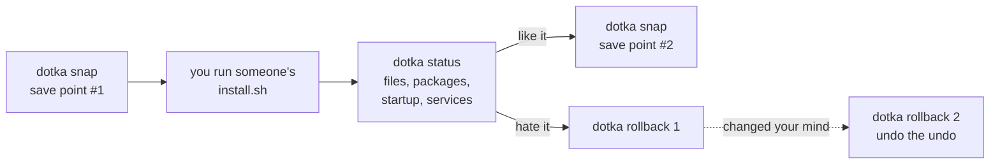

# dotka

**A time machine for your Linux user environment.**

You found some sick Hyprland dotfiles, cloned the repo and ran `./install.sh`. Cool. Now,
which of your files got overwritten? What packages did it pull? What's going to run every
time you log in? And how do you go back if you hate it?

dotka answers all of that. It takes **save points** of your setup (config files,
packages, user services and everything that runs at login), shows you exactly what an
installer changed, and lets you roll back. Think Nix generations, minus having to rewrite
your whole config in a new language.

> Beta software. It's careful by design (see [Safety](#safety)), but it's young, so keep
> that in mind.



More diagrams (what happens inside `run` and `rollback`) in [docs/how-it-works.md](docs/how-it-works.md).

## Quick taste

```bash
dotka init                              # save your current setup as save point #1
dotka run -- ./install.sh               # run an installer, see what it changed
dotka why waybar                        # who added this? -> by `./install.sh`
dotka doctor                            # anything broken or sketchy in your config?
dotka rollback 1                        # go back (shows a plan, asks first)
dotka                                   # or just open the interactive UI
```

What `dotka status` looks like after a typical rice installer:

```
Files     +8  ~3  -0
  ~ .config/hypr/hyprland.lua
  ~ .config/kitty/kitty.conf (file -> symlink: ~/dots/kitty.conf) [!] your file was replaced by a symlink
  + .config/waybar/ (3 files)
Packages  +4  -0 (1 AUR/foreign added)
  + cava
  + waybar
Startup   +6  -2
  + hypr-autostart ~/.local/bin/rice-autoupdate.sh  .config/hypr/hyprland.lua:6 [risk: runs a local script]
  + shell-remote   eval "$(curl -fsSL https://...)"  .zshrc:4 [heuristic] [risk: downloads and runs code]
  - hypr-autostart nm-applet  .config/hypr/hyprland.lua:7
```

That last section is the stuff git can't tell you btw: what now runs by itself, and that
the installer quietly removed your network applet from autostart.

## Install

**Arch (AUR):** coming soon as `dotka-git`.

**From source** (Go 1.24+):

```bash
git clone https://github.com/iYeremy/dotka
cd dotka
go build -o dotka ./cmd/dotka
sudo install -Dm755 dotka /usr/local/bin/dotka
```

Or `go install github.com/iYeremy/dotka/cmd/dotka@latest`.

## Try it without touching your config

Not ready to point it at your real setup? Fair. There's a sandbox: a fake home with a
Hyprland config and a fake "rice" repo whose installer does all the shady stuff
(overwrites configs, adds packages, a user service, a `curl | sh` in `.zshrc`).

```bash
go build -o dotka ./cmd/dotka
scripts/sandbox.sh setup
eval "$(scripts/sandbox.sh env)"          # points dotka at .sandbox/home
./dotka init
./dotka run -- .sandbox/super-rice/install.sh
./dotka                                   # poke around the UI
./dotka rollback 1
scripts/sandbox.sh clean
```

Full walkthrough in [docs/guide.md](docs/guide.md).

## The interactive UI

Run `dotka` with no arguments (or `dotka tui`). Five tabs, one per question you actually
have:

| Tab | Answers |
|---|---|
| 1 Overview | how am I doing? anything changed? anything wrong? what can I do? |
| 2 Changes | what exactly changed since my last save point? |
| 3 History | my save points, and what going back to each would do |
| 4 Startup | what runs by itself at login or when I open a terminal |
| 5 Health | broken or sketchy stuff in my config |

The detail pane explains everything in plain words (no "XDG autostart entry" jargon
without context), and every action shows what will happen and asks first.

| Key | Action |
|---|---|
| `1`-`5`, left/right | switch tab |
| `j`/`k`, up/down | move (or scroll the detail) |
| `tab`, `enter` / `esc` | list <-> detail / back |
| `s` | save a point |
| `u` | discard unsaved changes |
| `b` / `x` | History: go back to / forget the selected save point |
| `i` | set dotka up (first time) |
| `r`, `?`, `q` | refresh, help, quit (`ctrl+c` always quits) |

Needs a terminal of at least **70x20**. Output is plain ASCII with the 16 ANSI colors, so
it looks the same on the Linux console, in tmux and over SSH. `NO_COLOR` is respected and
nothing relies on color alone. No mouse yet. Design notes and real screenshots:
[docs/tui.md](docs/tui.md).

## Commands

| Command | What it does |
|---|---|
| *(none)*, `tui` | open the interactive UI |
| `init [--yes]` | set up dotka and save point #1 (asks first on your real home) |
| `snap -m MSG` | save a point |
| `status` | what changed since the current save point |
| `diff [A [B]] [--path P] [--patch]` | compare save points, or a save point with now |
| `run [-m MSG] -- CMD...` | save, run CMD, save again, show what CMD changed |
| `why THING` | where a file, package or startup item came from |
| `rollback N [--dry-run] [--yes] [--keep-new]` | go back to save point N (can be undone) |
| `log`, `show N` | list / inspect save points |
| `startup` | everything that runs at login or shell start |
| `doctor` | health check (read-only, works without `init`) |
| `track ls/add/rm PATH` | choose what gets tracked |
| `secrets ls/allow/deny PATH` | files skipped because they look like credentials |
| `forget N`, `prune --keep N` | delete old save points and free their space |
| `gc` | maintenance: delete stored copies nothing uses anymore |

## What it understands

**Tracked by default:** `~/.config`, `~/.local/bin`, fonts, themes, icons, `.desktop`
files and the usual shell/X files (`.zshrc`, `.bashrc`, `.profile`, `.xinitrc`...). Caches,
browser profiles, Steam and Electron junk are skipped. Add more with `dotka track add`.

**Startup map**, i.e. what runs by itself:

| Source | What's read |
|---|---|
| Hyprland | `hyprland.lua` (`hl.exec_cmd` in `hl.on("hyprland.start")`, following `require`) and `hyprland.conf` (`exec-once`, `exec`, `source`) |
| sway / i3 | `exec`, `exec_always`, `include` |
| niri | `spawn-at-startup`, `spawn-sh-at-startup` |
| river | `riverctl spawn` in `init` |
| Wayfire | `[autostart]` in `wayfire.ini` |
| bspwm, Openbox, labwc, herbstluftwm | their autostart scripts (heuristic) |
| KDE Plasma | `plasma-workspace/env` scripts |
| Any desktop | XDG autostart (`~/.config/autostart`), systemd user units |
| Your shell | `curl \| sh`, `eval`, `source`, plugin managers in rc files |

Qtile, awesome and xmonad configs are actual code, so their autostart isn't understood
yet. `dotka doctor` and `dotka startup` tell you when that's the case instead of
pretending everything's fine.

## Platform notes

- **Arch and friends** (CachyOS, EndeavourOS, Manjaro): full support, including
  packages (pacman + AUR).
- **Other distros:** everything works except the packages section, which just doesn't
  show up (pacman only for now).
- **NixOS / home-manager:** works as a viewer and for the imperative parts. Links into
  `/nix/store` are shown but never touched by `rollback` (home-manager owns them). See
  [docs/nixos.md](docs/nixos.md).
- **`~/.config` is assumed.** If you set `XDG_CONFIG_HOME` somewhere else (rare), dotka
  won't track it automatically. `dotka doctor` warns you and tells you the `track add`
  command to fix it.

## Safety

- **Read-only first.** `status`, `diff`, `startup`, `doctor`, `why` and the UI never
  change anything.
- **Asks before acting.** `rollback` and `forget` show a plan first. On your real home,
  `init` explains exactly what it'll do and asks for an explicit yes.
- **Never runs `sudo`** or touches packages. It prints the `pacman` command for you to
  review and run.
- **Rollback can be undone.** Before going back, your current state is saved as a new
  save point.
- **Won't delete what it can't bring back.** Secrets and huge files that weren't stored
  are left alone, and so are folders that still have untracked stuff in them.
- **Never writes outside your home** and never follows symlinks while restoring.
- **Secrets stay out.** Files that look like credentials aren't copied unless you say so
  (`dotka secrets allow`), and their content is never printed.
- **Honest about guesses.** Pattern-based detections are marked `[heuristic]`. `doctor` is
  a static check, not a security audit.

## Known limitations

- The store (`~/.local/share/dotka`) is private (0700) but not encrypted.
- `dotka run` runs the command for real, no isolation. A sandboxed `dotka try` is planned.
- Change detection trusts file size + modification time between scans (like `make`). A
  tool that edits a file and restores its old mtime could slip through.
- Packages: pacman only.

## Docs

- [docs/guide.md](docs/guide.md): user guide (concepts, walkthrough, reading the output)
- [docs/how-it-works.md](docs/how-it-works.md): diagrams and internals
- [docs/tui.md](docs/tui.md): UI design with real screenshots
- [docs/nixos.md](docs/nixos.md): notes for NixOS / home-manager users

## Development

```bash
go test ./...
go vet ./...
DOTKA_TUI_TEST_HOME=$PWD/.sandbox/home go test ./internal/tui -run Real -v   # UI against a sandbox
go test ./internal/tui -update                                              # regenerate UI golden files
```

Branches are `feat/...`, `fix/...`, `chore/...`, `docs/...`, merged into `main` with
`--no-ff`. Commits look like `type: short description`.

## License

MIT
