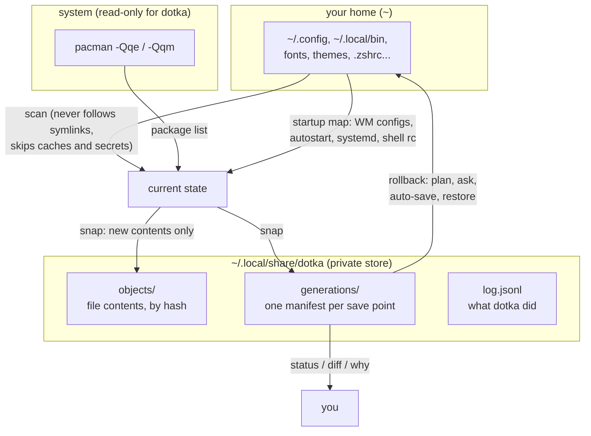
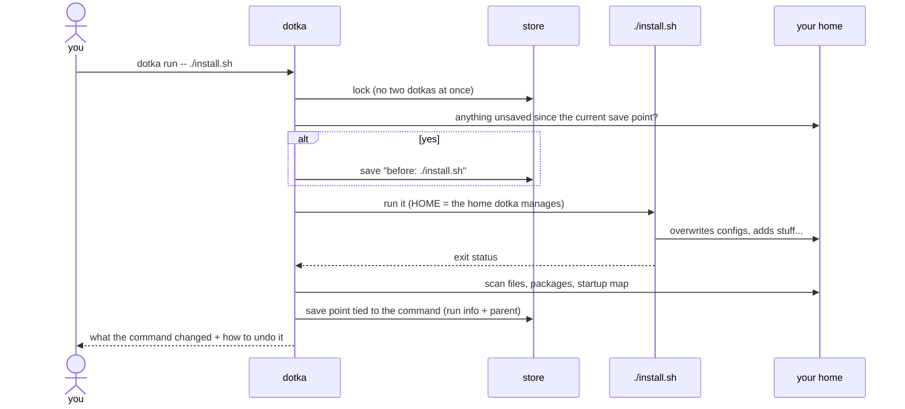
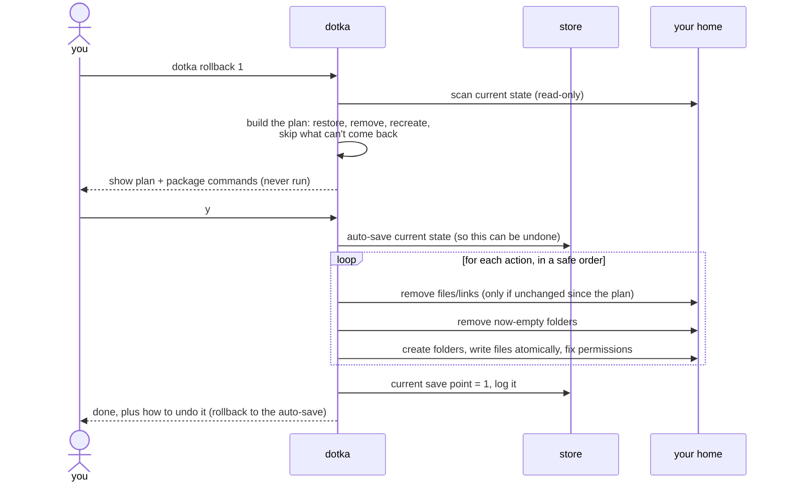
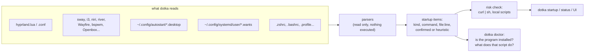
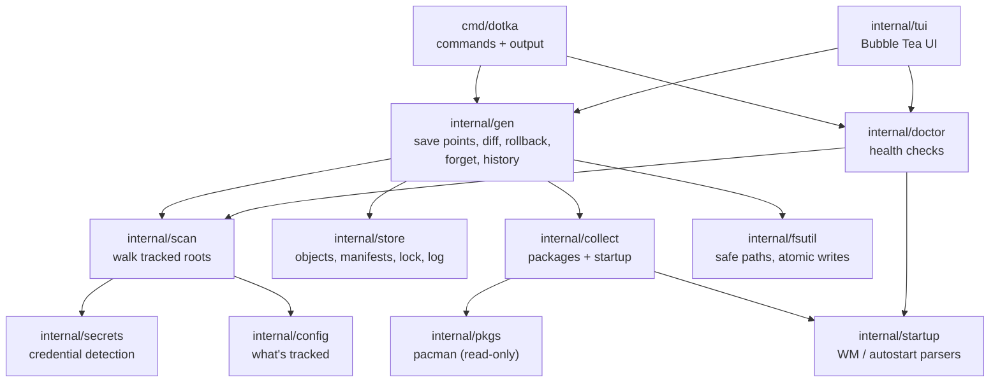

# How dotka works

Diagrams render on GitHub and GitLab (Mermaid). If you're reading this in a terminal, the
ASCII bits still make sense on their own.

## The big picture

dotka sits next to your config and keeps save points of it. It reads a lot and writes
very little, and it only writes when you ask.



A **save point** is a manifest (a JSON list) that says "at this moment, this path had
this content, these permissions; these packages were installed; these things ran at
startup". The actual file contents live in `objects/`, named by their sha256, so the same
content is only ever stored once.

## What happens on `dotka run -- ./install.sh`



Two details that matter:

- If dotka manages a home that isn't your real one (like the sandbox), the command gets
  that home as `HOME` and the `XDG_*` dirs, so it can't write into your real config by
  accident.
- The save point remembers its **parent** (the save point you were on) and the command.
  That's what lets `dotka why` say "added by `./install.sh`" later, and not get confused
  by rollbacks.

## What happens on `dotka rollback N`



Rules the planner never breaks:

```
+----------------------------------------------------------------------------+
| never deletes something it can't bring back (secrets, huge files, files     |
|   it didn't store)                                                          |
| never removes a folder that still has untracked or kept stuff inside        |
| never touches links into /nix/store (home-manager owns them)                |
| never writes outside your home, never follows a symlink while writing       |
| never touches paths that weren't tracked in BOTH the target and now         |
| writes files via temp file + fsync + rename, so nothing is left half-done   |
+----------------------------------------------------------------------------+
```

## The startup map



Each item is identified by kind + file + command (not line number), so moving a line
around doesn't show up as a change, but adding or removing one does.

## The store on disk

```
~/.local/share/dotka/        (0700, only you)
  objects/ab/cdef0123...     file contents, named by sha256 (read-only)
  generations/000004.json    one manifest per save point (never modified)
  HEAD                       the current save point
  LAST_ID                    highest number ever used (numbers are never reused)
  log.jsonl                  every snap, rollback, forget...
  config.json                tracked roots, exclusions, size limit, allowed secrets
  lock                       held while dotka writes
```

## Code layout



The UI never does I/O while drawing: it goes `Backend -> commands -> messages -> Update
-> View`, so it can be tested without a terminal (see [tui.md](tui.md)).
